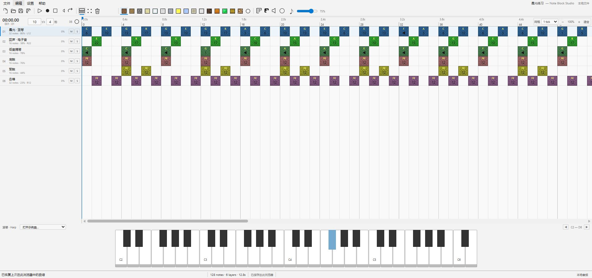

# Note Block Studio Web

[](https://github.com/sitbat/NoteBlockStudio-Web/actions/workflows/ci.yml)

非官方 Minecraft 项目，未经 Mojang 或 Microsoft 批准，与其没有关联。

基于 Open Note Block Studio v3.11.0 源码与素材的本地 Web 移植，使用 Rust / WebAssembly SIMD 音频核心。保留原版菜单、工具栏、音符网格、图层面板和钢琴布局；采样、变调、混音及每轨独立混响由真实 Rust / WebAssembly SIMD 内核和多个 Worker 计算。应用通过本机回环服务运行，不依赖在线托管或云端曲谱服务。



## 从源码启动

需要 Node.js 18+（建议24）和现代桌面 Edge / Chrome；已附真实编译的 WASM，正常使用不需要 Rust、GameMaker、Python 或 npm install。

```sh
git clone https://github.com/sitbat/NoteBlockStudio-Web.git
cd NoteBlockStudio-Web
npm start -- --open
```

服务仅监听 <http://127.0.0.1:8765>。保留终端，按 Ctrl+C 停止。也可以 Windows 双击 `start.bat`，Linux 运行 `./start.sh`。服务器提供音频线程所需的 COOP / COEP 与 WASM MIME；不能直接双击 index.html。首次发声需要一次点击。

源码仓库不提交 Node / FFmpeg 大型可执行文件。Node 从 PATH 或启动脚本支持的位置寻找；Windows MP3/FLAC/AIFF/OGG 编码可用以下命令下载经固定 SHA-256 校验的 FFmpeg，也可用系统 FFmpeg 或设置 `NBS_FFMPEG`。

```sh
node scripts/setup-runtime.mjs --help
node scripts/setup-runtime.mjs --runtime ffmpeg-win32-x64
```

Linux 编码使用本机 FFmpeg；可选的便携 Node 下载、许可证、校验和安装边界见 [运行时下载](docs/RUNTIMES.md)。已有本地完整包可附带运行时，不等同于 Git checkout 的依赖内容。

```sh
./start.sh --port 8766
./start.sh --open-file "/path/to/song.nbs"
./start.sh --player --open-file "/path/to/song.nbs"
./install-linux.sh
./uninstall-linux.sh
```

桌面安装只写当前用户的应用、MIME 与 nbs:// 入口，保留既有默认关联。参数、依赖、卸载说明和实测范围见 [Linux 说明](docs/LINUX.md)。

## v3 补充功能

- 完整宏编辑：颤音、立体声、琶音、滑音、颤音高、错开、合唱、音量 LFO、淡入淡出、替换音高及设置力度/声像/微调等，并支持撤销。
- 原版 NBP 图案、原版鼓组示例、普通及压缩分段代码、和弦插入、扩展选择、图层管理与曲谱统计。
- MIDI 导入的速度、网格精度、八度、音域折叠、轨道上限、音色/鼓音映射，含原版 GM 预设；Web MIDI 多设备实时/步进录制、力度、声像、弯音与踏板输入，监听也使用 Rust 内核。设备权限仅在手动点击时申请。见 [MIDI 说明](docs/MIDI.md)。
- Minecraft schematic、结构 NBT、分支/轨道结构、数据包、七种可视化、扩展音域/材质/自定义音色资源包，以及结构/数据包导入。详细兼容范围见 [Minecraft 说明](docs/MINECRAFT.md)。
- 通过本机 FFmpeg 导出 MP3、FLAC、AIFF、OGG，以及多采样率/单声道 WAV；直接 WAV 使用同一 Rust 内核渲染。FFmpeg 的平台依赖见 [runtime](runtime/README.md)。
- 自定义 PCM 与当前曲谱一起自动保存；`.nbpz` 完整工程包包含曲谱和已加载采样。曲谱快照每 5 分钟一次，最多保留 20 个，也可手动备份。快照是曲谱历史；完整工程包才携带音频。
- 浅色/深色主题及显示偏好、电脑键盘弹奏、敲击测速、本地 URL / nbs:// 打开、播放器入口、离线更新预览/应用/回滚。
- Discord 活动默认关闭，只有手动启用后才连接本机 Discord，显示曲名和编辑/播放状态。没有账号登录或云端歌曲存储。

[功能对照](docs/FEATURE-PARITY.md) 列出原功能的 Web 对应、差异和验证范围；[迁移说明](docs/MIGRATION.md) 列出文件和运行边界。

## 每轨混响与万轨

每条轨道只有一个 **0–100% 混响强度**，混响状态逐轨独立；不提供单独的干度、湿度或阻尼调节。多声道采样在 DSP 前平均下混为单声道，再计算声像与混响。

默认 **14 Worker / 256 帧 / 4 块预读**，48 kHz 下配置预读为 21.33 ms。播放性能窗口提供真实 10,000 轨持续同时发声和独立混响测试，统计欠载、丢声、输出及在线控制。已在记录中的 Ryzen 9 9950X3D / Windows Edge 环境完成一分钟测试；最新结果以 [验证记录](docs/VERIFICATION.md) 与原始报告为准。配置预读、控制确认、浏览器设备延迟是不同指标，不能把预读当成端到端声学延迟，也不保证其他机器和后台负载具有相同结果。

## 编辑与文件

网格点击添加音符，右键删除；B / V / E 切换画笔/选择/橡皮；Space 播放暂停；Esc 停止；Home 回到开头。Ctrl+Z / Ctrl+Shift+Z 撤销重做，Ctrl+C/X/V 复制剪切粘贴，Ctrl+D 复制选区，方向键移动，Shift+上下移调，Alt+上下升降八度。启用电脑键盘弹奏后，Z–M / Q–U 区域用于琴键，覆盖相应编辑快捷键。

双击图层设置名称、音量、声像、锁定和混响；M / S 为静音/独奏。当前曲目、采样和偏好存于当前浏览器、当前端口；不同浏览器/端口不共享，清除站点数据会删除本地缓存。重要作品保存为完整工程包。

NBS 可读取经典格式与 v1–v5，写出 v5；标准长度最多 65535 ticks、自定义乐器最多 240 个。私有 `ONBSWFX1` 尾部保存本版额外轨道状态，第三方编辑器可能忽略或丢弃；原生桌面实机兼容未验证。NBS / JSON 不内嵌自定义音频，NBP 不包含所有项目属性。音频导出为一轮播放加采样/混响尾音，不将无限循环展开。

## 开发

```sh
npm test
./scripts/build-wasm.sh
node scripts/apply-update.mjs /path/to/update.zip
```

Windows 重建可用 `powershell -ExecutionPolicy Bypass -File scripts/build-wasm.ps1`。使用随附 WASM 无需 Rust、GameMaker 或 Python。构建使用无外部 crates 的离线 Cargo、SIMD128、release/LTO；标量对照由 `NBS_SCALAR_WASM` 指向另行编译产物。更新器默认只预览，应用和回滚见 [离线更新](UPDATING.md)。

贡献流程见 [CONTRIBUTING.md](CONTRIBUTING.md)。Git checkout 建议使用 Git 更新；离线更新器面向含完整发布清单的安装包。

OpenNBS 原源码保留 [MIT 许可证](LICENSE)，音色、示例曲和其他素材按 [第三方说明](THIRD_PARTY_NOTICES.md) 标注来源及各自权利人。运行时许可证与来源独立保留；它们不因编辑器使用 MIT 而重新授权。没有执行原归档中的 EXE/DLL；原生 DLL/Python 内部实现由 Web/Rust/本地服务替代，不提供任意原生插件二进制加载。
