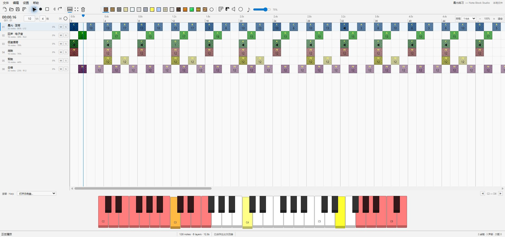

# Note Block Studio Web

[](https://github.com/sitbat/NoteBlockStudio-Web/actions/workflows/ci.yml)

非官方 Minecraft 项目，未经 Mojang 或 Microsoft 批准，与其没有关联。

v4 是基于 Open Note Block Studio v3.11.0 源码与素材重写的**纯静态网站**。保留原项目风格的菜单、网格、图层与钢琴，使用 Rust / WebAssembly SIMD 和多个 Worker 播放采样、混音及计算每轨独立混响。音频编码也在浏览器内完成，没有应用后端、歌曲上传或云项目存储。



## 构建与使用

构建机需要 Node.js 18+，建议 24；依赖和已编译 WASM 随仓库提供，无需 `npm install`、Rust、GameMaker 或本机 FFmpeg。

```sh
git clone https://github.com/sitbat/NoteBlockStudio-Web.git
cd NoteBlockStudio-Web
npm run build
```

将生成的 **`dist/` 内全部文件**上传到 HTTPS 静态托管目录，保持目录结构。服务器只需提供静态文件，不需要 Node.js、容器或编码进程。详细要求见 [静态部署](docs/DEPLOYMENT.md)。这里提供构建与部署方法，不会替使用者公开发布网站。

开发时可运行：

```sh
npm start
```

它只是本机静态预览工具，按终端输出的 localhost 地址访问；不是生产服务器依赖。不要双击 `index.html`。首次进入 HTTPS / localhost 站点时，Service Worker 会建立音频线程所需的跨源隔离，可能自动重载一次；首次发声仍需要用户点击。建议使用现代桌面 Edge / Chrome。

## 功能

- 网格编辑、拖动、多选、剪贴板、重复、撤销重做、图层管理、音高/力度/声像/微调，以及每轨混响、静音、独奏和锁定。
- NBS / MIDI / JSON 导入导出；原版 NBP 图案、普通及压缩分段代码、和弦、条件选择、15 个音乐宏和敲击测速。
- MIDI 速度折算、精度/音域/GM/鼓音映射；Web MIDI 多设备实时和步进录制，只有手动操作时申请设备权限。见 [MIDI 说明](docs/MIDI.md)。
- Minecraft schematic、结构 NBT、分支/轨道结构、数据包、七种可视化、扩展音域/纹理/自定义 OGG 资源包。见 [Minecraft 说明](docs/MINECRAFT.md)。
- Rust 内核直接生成 WAV；随包的浏览器 FFmpeg / WebAssembly 编码 MP3、FLAC、AIFF、OGG，以及界面支持的采样率和通道转换。**音频不上传到服务器。**
- 自定义采样与曲谱在浏览器自动保存；`.nbpz` 完整工程包携带音频。每隔至少 5 分钟保存曲谱快照，最多 20 个，也可手动备份。
- 浅色/深色主题、显示偏好、电脑键盘弹奏、播放器界面与用户发起的 URL 导入。外部链接需允许浏览器 CORS，可先下载文件再导入。
- v4.1 补齐播放时的琴键黄闪、下压回弹、网格音符渐亮，以及按住琴键、删除轮廓和对话框过渡。动画跟随音频实际消费进度，保留原版鼓组和自定义音色的琴键反馈规则。见 [播放动画](docs/PLAYBACK-ANIMATIONS.md)。

网站保留音乐编辑和文件功能；不提供 Discord 桌面 IPC、操作系统 `nbs://` / 文件关联安装、从命令行读取指定本机文件，或原生 DLL/Python 插件。粘贴的 `nbs://` 链接仍可作为 HTTP(S) 曲谱地址解析。完整差异见 [功能对照](docs/FEATURE-PARITY.md) 与 [迁移说明](docs/MIGRATION.md)。

## 每轨混响与万轨

每轨有独立混响状态，界面调节 0–100% 强度；房间预设固定。多声道采样在 DSP 前平均下混为单声道，再计算声像与混响。

默认 14 Worker / 256 帧 / 4 块预读，48 kHz 的配置预读为 21.33 ms。性能窗口可运行真实 10,000 轨同时发声与独立混响测试，并记录欠载、丢声与控制状态。当前纯静态版已在本机 Edge 完成一分钟测试：10000 轨、独立混响、在线控制、零欠载和零丢声，见 [v4 验证](docs/VERIFICATION-static.md)；历史记录见 [v3 验证](docs/VERIFICATION.md)。结果不保证其他设备、浏览器或后台负载达到相同性能，预读也不等于端到端声学延迟。

## 编辑与保存

点击网格添加音符，右键删除；B / V / E 切换画笔/选择/橡皮，Space 播放暂停，Esc 停止，Home 回到开头。Ctrl+Z / Ctrl+Shift+Z 撤销重做，Ctrl+C/X/V 复制剪切粘贴，Ctrl+D 重复选区，方向键移动，Shift+上下移调，Alt+上下升降八度。启用电脑键盘弹奏后，相应琴键会覆盖编辑快捷键。

双击图层修改名称、音量、声像、锁定与混响，M / S 静音/独奏。自动保存按浏览器来源隔离，清除站点数据会删除本地缓存；重要作品另存 `.nbpz`。历史快照只保存曲谱，不是历史音频备份。

NBS 读取经典格式与 v1–v5，默认写 v5，标准长度最多 65535 ticks，自定义乐器最多 240 个。私有 `ONBSWFX1` 尾部保存本版轨道状态，第三方编辑器可能忽略或丢弃；NBS / JSON 不嵌入自定义音频。音频导出生成一轮播放和尾音，不展开无限循环。

## 开发与来源

```sh
npm test
./scripts/build-wasm.sh
```

Windows 重建 Rust 可用 `powershell -ExecutionPolicy Bypass -File scripts/build-wasm.ps1`。只有重建 DSP 才需要 Rust 与 `wasm32-unknown-unknown`；使用随包 WASM 不需要安装工具链。分工见 [架构](docs/ARCHITECTURE.md)，开发与验收见 [贡献说明](CONTRIBUTING.md)，站点更新见 [UPDATING.md](UPDATING.md)。

早期验证记录包含本机 Node、原生 FFmpeg、Linux 启动器和系统桥接测试，保留作历史证据，不是当前静态网站的运行要求。当前浏览器依赖来源见 [RUNTIMES](docs/RUNTIMES.md)。

项目代码及原源码保留 [MIT 许可证](LICENSE)。原音色、示例曲、图标和浏览器编码器按 [第三方说明](THIRD_PARTY_NOTICES.md) 与随包许可证标注，各自许可不因本项目使用 MIT 而改变。没有执行原归档中的 EXE/DLL。
