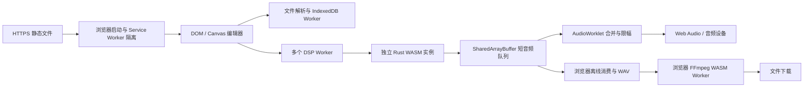

# 纯静态网站与 Rust 音频架构

应用以静态文件交付。编辑、解析、存储、实时 DSP、WAV 渲染和其他音频编码均在浏览器执行；部署端只提供文件，没有应用 API、歌曲上传或服务器转码进程。Node.js 是构建、测试与开发预览工具，不是部署运行时。

## 文件分工

| 文件或目录 | 职责 |
| --- | --- |
| `index.html`、`styles.css`、`js/app.js` | 原项目风格的编辑器、可视区绘制、选择、属性与菜单 |
| `js/native-menus.js`、`css/native-menus.css` | 原生风格网页菜单；名称不表示操作系统桥接 |
| `js/model.js`、`js/edit.js`、`js/layer-tools.js` | 项目规范化、历史与原子编辑/图层操作 |
| `js/feature-ui.js`、`js/editor-tools.js`、`js/patterns.js` | 音乐工具、宏、图案、项目包和导出交互 |
| `js/file-worker.js`、`js/project-store.js` | 后台解析、规范化和 IndexedDB 自动保存 |
| `js/formats.js`、`js/project-effects.js` | NBS / MIDI 编解码和 `ONBSWFX1` 私有尾部 |
| `js/project-bundle.js`、`js/archive.js` | 携带 PCM 的工程 ZIP、CRC 与解压边界 |
| `js/audio.js`、`js/audio-resample.js` | 原音色表、解码/采样工具、WAV 编码和资源包变速重采样 |
| `js/wasm-audio.js` | Rust 实例池、分片、PCM 上传、播放调度、WAV 渲染与统计 |
| `js/dsp-protocol.js`、`js/dsp-worker.js` | 环形队列、共享控制、事件时间线与 Rust 渲染任务 |
| `js/output-worklet.js` | 只消费已就绪 PCM，合并分片、限幅并统计欠载 |
| `rust/src/lib.rs`、`wasm/nbs_dsp.wasm` | DSP 源码及已编译 SIMD 内核 |
| `js/browser-codecs.js`、`vendor/` | 浏览器编码器适配层与随包 FFmpeg WASM 依赖 |
| `js/midi-input.js` | 浏览器授权后的设备消息、录制与监听 |
| `js/minecraft.js`、`js/minecraft/` | NBT、红石结构、数据包、资源包的浏览器编解码 |
| `static-bootstrap.js`、`coi-serviceworker.js`、`js/browser-environment.js` | 首次启动、同目录 Service Worker 与音频环境诊断 |
| `js/browser-files.js` | 无服务端代理的 URL 校验和浏览器 CORS 读取 |
| `dist/` | 构建后可上传的静态站点，不包含开发服务与原生运行时 |

## 静态启动与安全上下文

实时音频依赖 SharedArrayBuffer，浏览器必须处于安全上下文和跨源隔离中。已有隔离时启动模块直接加载应用；否则注册同目录 Service Worker，取得控制并补充 COOP / COEP，必要时最多自动重载一次。应用目录可位于子路径。冲突控制器、被禁止的隔离策略等失败会留在启动诊断页，不强行替换其他应用的 Worker。

Service Worker 不使用 CacheStorage，只透传并修改作用域内的同源 GET 响应；不修改外域、POST、Range/分段、重定向等特殊响应，不缓存工程或音频。不能通过 `file://` 或普通远程 HTTP 获得等价运行环境，也不进行非共享内存 DSP 降级。

JS、Worker、AudioWorklet、WASM、编码器和采样保持在同一静态目录结构。浏览器编码器按需加载随包文件，不从外部 CDN 拉取执行代码。部署步骤与限制见 [DEPLOYMENT](DEPLOYMENT.md)。

## DSP 内存与独立性

每个 DSP Worker 有自己的 WASM 堆，不共享 Rust 可变状态。曲目按连续轨道范围分片，每轨拥有四条延迟线和四个阻尼状态。SIMD 一次处理四轨，四个 lane 反馈互不交叉，最终立体声输出才按轨相加。

固定混响预设为延迟 13 / 17 / 19 / 23 ms、反馈 0.82、阻尼 0.45。界面只暴露每轨 `reverb=0..100`，Rust 接收 0–1，采用 `sqrt(1-r)` 干声与 `sqrt(r)` 湿声。轨道增益变更最多用 32 个采样平滑；声像和混响比例不是同一项平滑。

48 kHz 下，每轨延迟线共 3456 个 float，即 13824 字节；10,000 轨约 132 MiB，分片四轨补齐后略增。整个应用还需要滤波状态、声音池、样本、WASM 堆、JS 和共享缓冲，不能把延迟线大小当作总内存。

PCM 在播放前上传，每个声音保存采样 ID、相位、速率、增益、声像、起始偏移和循环标志，以线性插值读取单声道 PCM。多声道样本先平均下混，不保留原立体声场。默认声音池容量为分片轨数乘以 `voicesPerTrack=4`，可配置 1–64，单实例最多 1,000,000 个槽位；满池会报告丢声，不隐藏失败。

## 共享队列与实时输出

每分片的 SharedArrayBuffer 环形队列有 32 个槽位，但只按配置的少量预读块渲染，不填满物理容量来隐藏延迟。AudioWorklet 不等待 Worker，缺块时跳过该分片并记录欠载；回调中没有文件访问、解码或 Rust 堆扩容。

渲染泵每任务最多补 16 块，约 3 ms 后让出执行；队列满时最多 `Atomics.wait` 2 ms，通过计时器与 MessageChannel 交替唤醒。音量、声像、混响、静音通过显式 UI 更新发布版本化共享参数；25 ms 监视器只读消费游标、更新进度和判断结束。未来事件更新保留已有混响状态。

默认 14 Worker / 256 帧 / 6 块预读，48 kHz 的配置预读为 32 ms。预读不是端到端声学延迟；线程、浏览器和设备调度仍影响稳定性。

## 音频文件与浏览器编码

WAV 导出使用同一 Rust 核心，以离线消费队列生成立体声 PCM，不是麦克风或声卡回录。额外格式由浏览器 FFmpeg WASM Worker 从 WAV 编码，虚拟文件和编码缓冲位于访问者设备内存，没有 `/api/transcode` 或上传服务。

自定义 Minecraft 音色先按根音和扩展八度真正重采样 PCM，输出合法采样率 WAV，再在浏览器编码为 OGG Vorbis 并打包。重采样使用有界窗口 sinc 滤波，检查扩展帧数，避免仅改 WAV 头产生异常采样率。

编码器的运行成本、内存和初始化时间属于客户端负载，不能套用历史原生 FFmpeg 子进程性能。依赖来源及许可证见 [RUNTIMES](RUNTIMES.md)。

## 编辑、存储与文件边界

宏和批量操作通过一次历史记录提交，先验证目标及数量限制，锁定轨不接受编辑。MIDI 文件解析由文件 Worker 处理；Web MIDI 只在显式点击时授权，实时监听使用独立的 Rust 声音池，不重启主播放池。

IndexedDB v2 分别保存当前项目、PCM、历史元数据与曲谱快照。只有采样缓冲身份变化时复制 PCM；项目与对应样本银行在同一事务提交。完整工程 ZIP 保存 JSON 和已解码多声道 Float32 WAV，不保留原压缩文件字节。曲谱快照不携带历史音频。

ZIP / NBT / Minecraft 导入检查路径、CRC、展开体积、音符数和时间线。`archive.js` 的 Node zlib 分支只服务 Node 测试环境，浏览器使用自己的压缩 API，不要求服务器安装 Node。

URL 导入只由用户操作触发，使用无凭据 CORS GET、时间及大小限制；不提供服务端 URL 代理。项目没有账号、服务器保存、Discord IPC、文件关联安装或任意原生插件执行。

## 构建与证据

`npm run build` 复制并验证静态站点所需文件，`npm start` 只做开发预览。Rust 重建使用离线 Cargo、`wasm32-unknown-unknown`、SIMD128、release/LTO 和 panic abort；独立标量 feature 用于对照。Rust 不是访问者或静态服务器的安装要求。

[VERIFICATION](VERIFICATION.md) 与 `benchmarks/` 保留早期本机服务、原生编码及平台桥接证据；这些历史记录不是当前网站的服务器依赖，也不等于当前静态版已完成同样环境的验收。
