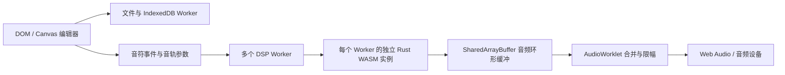

# Rust v3 架构

音频计算与编辑界面分开执行。Rust 核心负责采样、声音混合和每轨独立混响；JavaScript 负责编辑、文件、解码、线程通信及最终输出。

## 文件分工

| 文件 | 职责 |
| --- | --- |
| `index.html`、`styles.css`、`js/app.js` | 原项目风格的编辑器、可视区域绘制、选择、属性和菜单 |
| `js/model.js`、`js/edit.js` | 项目规范化、历史、组移动和原子粘贴 |
| `js/file-worker.js`、`js/project-store.js` | 后台文件解析、规范化及 IndexedDB 自动保存 |
| `js/formats.js`、`js/project-effects.js` | NBS / MIDI 编解码与 `ONBSWFX1` 私有尾部 |
| `js/audio.js` | 原音色表、浏览器解码、采样管理与基础音频工具；当前界面播放入口使用其 Rust 派生实现 |
| `js/wasm-audio.js` | 实例池、分片、PCM 上传、播放调度、WAV 导出、统计与压测 |
| `js/dsp-protocol.js` | 环形缓冲、事件时间线、共享控制和诊断字段 |
| `js/dsp-worker.js` | 执行 Rust 渲染，发布 PCM 和工作线程统计 |
| `js/output-worklet.js` | 只消费已就绪 PCM，合并各分片、限幅并统计欠载 |
| `rust/src/lib.rs`、`wasm/nbs_dsp.wasm` | Rust 源码与已编译 SIMD 音频内核 |
| `server.mjs`、`native-services.mjs` | 本机静态服务、跨源隔离、受令牌和同源保护的 FFmpeg / Discord / 显式启动文件与 URL 服务 |
| `hosted-server.mjs`、`hosted-services.mjs` | 网站静态白名单、固定公开来源、会话校验、限额与临时 FFmpeg 编码，不接入本机能力 |
| `js/service-capabilities.js` | 区分本机/网站能力、网站会话过期后单次重试与受限浏览器 URL 读取 |

## DSP 内存与独立性

每个 Worker 有自己的 WASM 堆，不共享 Rust 可变状态。曲目按连续轨道范围分片，每轨拥有四条延迟线和四个阻尼状态。SIMD 一次处理四轨：四个 lane 是四条独立轨道，反馈不会跨 lane。只有最终立体声输出按轨相加。

固定预设为延迟 13 / 17 / 19 / 23 ms、反馈 0.82、阻尼 0.45。UI 只暴露每轨 `reverb=0..100`，传入 Rust 时缩放至 0–1，使用 `sqrt(1-r)` 干声与 `sqrt(r)` 湿声。轨道增益变更最多用 32 个采样平滑；声像及混响比例并非同样的 32 样本渐变。

48 kHz 时，每轨四延迟线共 3456 个 float，即 13824 字节。10,000 轨的延迟内存约 132 MiB，分片补齐四轨组后略增；还需要滤波状态、输入块、声音池、采样、输出缓冲、WASM 堆、JS 与共享传输内存，不能把 132 MiB 当作整个应用的内存。

渲染不创建采样缓冲或扩容声音池。PCM 在播放前上传；每个声音保存采样 ID、相位、速率、增益、声像、起始偏移和循环标记，以线性插值读取单声道 PCM。多声道文件在 JS 中先平均下混，不保留原立体声声场。

分片声音池默认容量为 `本分片轨数 × voicesPerTrack`，倍率默认 4、可配置为 1–64。单实例最多 1,000,000 个槽位。满池时新声音返回失败并计数，不会通过隐藏丢声满足表面活跃轨数。

## 共享队列与实时输出

每个分片的 SharedArrayBuffer 环形队列有 **32 个槽位**。物理容量与实际预读块数不同：Worker 只按配置的少量预读块生成音频并发布序号，不会填满全部 32 槽来隐藏延迟。AudioWorklet 不等待 Worker；缺块时跳过该分片并记录欠载。输出回调没有文件访问、解码或 Rust 堆分配。

渲染泵用有界批次追赶预读水位：每个任务最多补 16 块，约 3 ms 后让出执行。队列满时最多 `Atomics.wait` 2 ms，并通过计时器任务与 MessageChannel 交替唤醒，给参数、停止和样本消息提供执行机会。它保留原有 FDN 状态，不会靠重置混响来快速补块。

音轨音量、声像、混响和静音状态通过**显式 UI 更新**发布版本化共享参数。25 ms 播放监视器只读消费游标、更新进度和判断结束，不再定时扫描全部 10,000 个轨道参数。显式变更调用 `updateTrackParams` 比较轨道值，只发布发生变化的分片版本；Worker 仅在版本改变时复制并应用其参数。未来音符列表由消息更新，保留已有混响状态。文件线程和 UI 不在 AudioWorklet 中运行，但它们仍可能受到系统 CPU 和调度竞争影响。

WAV 导出使用相同的 Rust 采样与混响渲染路径，以离线消费队列的方式生成立体声 PCM；它不是麦克风或声卡回录。

## Rust ABI 与重建

导出包括 `engine_create/destroy`、`engine_sample_alloc`、`engine_track`、`engine_voice`、`engine_render`、`engine_reset`、`engine_active_voices`、`engine_dropped_voices`、`engine_peak`、`engine_wasm_simd`，并提供采样率和混响缓冲字节诊断。音频输出为左声道完整一块后接右声道完整一块的平面 float32。

`scripts/build-wasm.ps1` 使用无外部 crates 的 Cargo 项目、`wasm32-unknown-unknown`、SIMD128、release 优化 3、LTO 与 panic abort。Cargo feature `scalar` 提供独立标量算法构建，用于对照；原生目标默认使用标量实现。随附 WASM 可直接使用，Rust 不是运行时安装要求。

浏览器需要跨源隔离以使用 SharedArrayBuffer，必须保留本地服务器的 COOP / COEP 响应头。运行、格式边界和实际测量见 [README](../README.md)、[迁移说明](MIGRATION.md) 与 [性能说明](PERFORMANCE.md)。

## v3 编辑、存储和本地协作

`feature-ui.js` 将原版菜单功能连接至纯编辑模块 `editor-tools.js`、`patterns.js` 与格式编解码。每次宏修改通过单次历史记录提交，锁定轨仍被排除。MIDI 解析选项经文件 Worker 处理；`midi-input.js` 只有显式点击才请求 MIDI 权限，实时监听使用单独的 Rust 声音池，不重启主播放池。

IndexedDB v2 将当前项目、PCM 采样、历史元数据及曲谱快照分开存储。只有采样缓冲身份变化时复制 PCM；项目和对应采样银行在同一事务提交。完整工程包使用带 CRC 校验的 ZIP，保存 JSON 和每个采样全部已解码声道的 float32 WAV。DSP 仍按原架构下混，完整包保留的多声道数据不等于 DSP 保留原声场。

`minecraft.js` 是结构/数据包/资源包导入导出的入口，NBT、红石布局和数据包逻辑在 `minecraft/`。导入和 ZIP 路径、CRC、展开体积、音符数和时间线均有边界检查。自定义 Minecraft 音色由本地 FFmpeg 转成真正的 OGG Vorbis 并生成基准及上下扩展八度。

本地服务只接受本机 Host；修改接口还要求精确 Origin 和每次启动随机令牌。编码使用参数白名单、无 shell 子进程、单任务并发、超时和体积限制。Discord 默认不连接；启用后仅使用本机 IPC。启动文件只读取 CLI 明确授予的路径，不接受任意 HTTP 查询路径。URL 导入仅由用户点击触发，不自动爬取外部来源。

Linux 入口优先使用包内官方 Node，桌面安装作用于用户 XDG 路径；测试在独立临时 XDG 环境进行。更新器验证完整发布清单与 SHA-256，暂存后替换并保留回滚备份，不在浏览器中下载或自动应用更新。

## 网站部署

网站模式保留相同的浏览器 DSP 与 IndexedDB；不把曲谱或播放任务转移到服务器。静态服务只提供页面、浏览器脚本、WASM 与素材，禁止目录穿越、链接跳转和服务端文件读取。启动时固定 `PUBLIC_ORIGIN`；反向代理必须保留 Host，来源校验不信任 forwarded 字段。

服务器只开放健康、能力查询与编码接口。HTTPS 下使用 Secure/HttpOnly/SameSite=Strict 会话 Cookie 与绑定会话的 HMAC 请求令牌；它用于跨站防护，不是账号登录。转码在接收上传前占用全局单任务槽位，验证有界 WAV，使用固定参数与无 shell FFmpeg 子进程，限制输入、输出、处理时间及客户端速率，完成或断开连接后清理临时文件。网站 URL 导入直接由浏览器执行并受 CORS 限制。

Compose 将应用放入内部网络，以非 root 用户运行，只读文件系统与有界临时盘；Caddy 单独处理公网 HTTPS。已有代理可使用 Nginx/systemd 模板。具体资源边界与操作步骤见 [服务器部署](DEPLOYMENT.md)。
