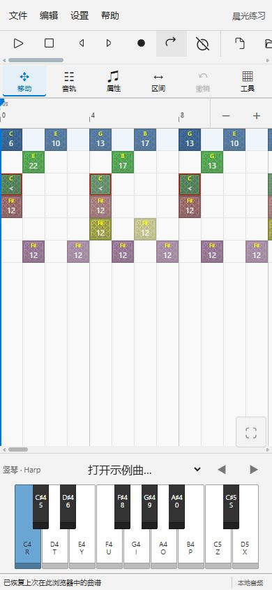
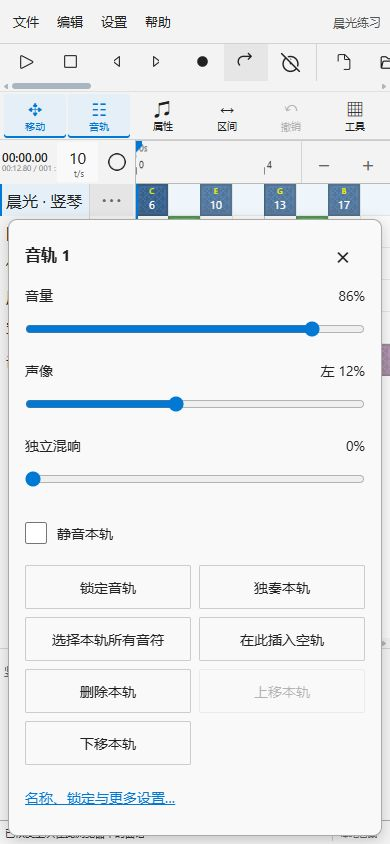

# 移动端与触控 · v4.3

手机和平板使用原编辑器的音符、图层和钢琴素材，调整导航和触控目标。服务器仍只提供静态文件；工程、采样、混音、独立混响和全部导出在浏览器本机运行。

## 操作

- 默认“移动”：单指拖动网格平移；双指移动并缩放时间轴，音轨行高保持不变。
- 点击“移动”切换为“编辑”：点按添加或选择音符，拖动绘制、移动或框选。可在“工具”中选择画笔、选择、橡皮。选择工具会进入编辑模式。
- 编辑时加入第二根手指会取消未完成笔画，再开始双指导航。剩余手指不会意外继续绘制。失去焦点、系统取消或旋转屏幕也取消未完成触控；保留原来的撤销和重做记录。
- 一整笔编辑只生成一个撤销步骤。“撤销”直接可点，完整撤销、重做与编辑功能也保留在菜单和展开的工具栏中。
- “音轨”显示或收起侧栏。侧栏单指上下滑动浏览音轨，点击 `⋯` 打开音量、声像、独立混响以及锁定、独奏和轨道操作。混响仍为每轨独立的一个 0%–100% 控制。
- “属性”打开音符属性底部面板；“区间”提供标尺右键菜单的全部操作。拖动标尺建立区间。
- “工具”展开完整工具栏，并显示网格吸附和整曲缩放。收起时工具栏仍可横向滑动，播放与停止优先显示。
- 手机菜单使用一页一层的导航，子菜单有返回和关闭；设置、音色、导出窗口可滚动，宽表格在窗口内部横向滑动。
- 钢琴支持多个触点同时按下和滑奏；松开一个触点不会释放其他触点。触摸边缘琴键不触发鼠标悬停自动换页，使用八度按钮切换音域。
- 播放进度和按住快进／倒带绑定发起的触点，另一根手指松开不会提前结束定位。手机播放器返回编辑器的入口保持可见。

常用工具、表单、菜单及混音面板按钮使用至少 44 px 的触控目标。为保持原曲谱的虚拟化和行对齐，音轨仍为 32 px 高；侧栏的每轨菜单入口为 44 px 宽。

## 验证范围

2026-10-24，Windows Edge 响应式视口检查：320×568、390×844、844×390、768×1024 及桌面。检查菜单返回、首选项、音轨混音、工具展开、网格吸附、属性与播放器；手机视口页面没有横向溢出。短横屏压缩钢琴显示并保留网格操作空间。

Node 24 完整回归 **327/327 通过，0 失败、0 跳过**；提供独立 scalar WASM，与随包 SIMD 音频执行差分。日志见 [完整回归](../benchmarks/windows-v4.3-mobile-tests.txt)。新增触控测试覆盖多指转换、缩放锚点、取消、笔画撤销、重做保留、碰撞处理、侧栏滚动、触点归属与菜单按钮的键盘激活。它们执行实际控制器和编辑历史接入代码。

普通本机静态预览逐个下载并校验全部 **552 个运行文件**，包括 WASM 校验和及 MIME；构建和测试工具不属于部署包。

本轮没有使用实体手机或 iOS Safari；浏览器视口测试不等于实体触控和声卡延迟测试。桌面的一万轨性能记录仍见 [静态版验证](VERIFICATION-static.md)，不能据此承诺手机达到相同负载。手机若出现音频欠载，可在混音设置中调整 Worker 和预读并运行性能测试。
