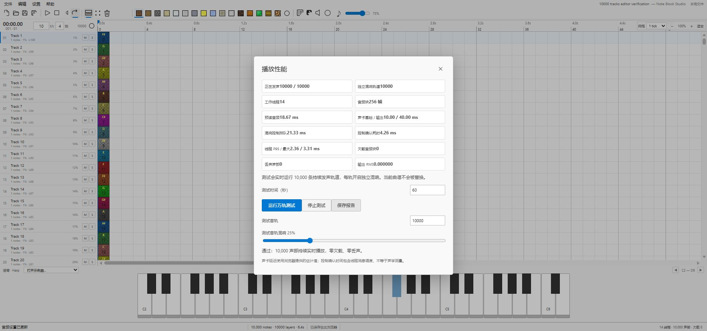

# 本地验证记录 · Rust v2

日期：2026-10-23。交付通过 `127.0.0.1` 运行，没有发布。本文件区分真实 WASM 正确性、离线 CPU 吞吐和浏览器实时输出；三者不是同一项验收。

## 已执行的 Rust / WASM 检查

已用稳定 Rust 1.99.1 / Cargo 1.99.1 / LLVM 23.1.1，将 `rust/src/lib.rs` 实际编译为 `wasm32-unknown-unknown` 的 release SIMD 二进制。没有以手工生成的 WASM 或 JavaScript 计算冒充 Rust。

实际运行：

```powershell
node --test rust/tests/wasm-abi.test.mjs
```

9 项测试全部通过，其中最后一项使用另行编译的标量 WASM（通过 `NBS_SCALAR_WASM` 指定）。默认命令未提供该路径时会跳过标量对比项。

| 检查 | 结果 |
| --- | --- |
| 实际 WASM 导出与 SIMD 标志 | ABI 可实例化并执行，SIMD 标志为 1 |
| 音量、声像、触发偏移 | 轨道增益、音符增益和块内触发位置符合预期 |
| 变调与采样循环 | 线性插值及跨块相位符合预期 |
| 0% / 100% 混响 | 0% 为干声；100% 产生延迟的左右声道尾音 |
| 每轨混响隔离 | 注入一轨后将其静音，其尾音不会泄漏到其他启用轨道 |
| 声音池与内存 | 满池拒绝可计数，重置后可复用，100 块渲染没有扩大 WASM 内存 |
| 非有限数与静音 | 非法参数和非有限 PCM 不产生非法输出数值 |
| 增益平滑 | 在 32 个采样内完成，包含跨 16 帧小块的变化 |
| SIMD / 标量一致性 | 9 轨、400 块、非零混响、不同增益渐变，最大差异小于 `1e-5` |

原生 `cargo check --tests --offline` 已通过。**未成功执行原生 Windows `cargo test`**：现有 MSVC 目录缺少可用 Windows SDK 链接库 `kernel32.lib`，`vcvarsall.bat` 也缺失。没有安装全局 Visual Studio 或 SDK。WASM 构建和以上实际执行不依赖该 SDK。

本次最终集中运行以下命令，使用 Node 24.19.0，耗时约 2768.47 ms，退出码为 0：

```powershell
node --test --test-reporter=tap tests/*.test.mjs rust/tests/*.test.mjs
```

共 83 项：**82 通过、0 失败、1 跳过**。跳过项是未提供标量二进制路径时的可选 SIMD / 标量对照。随后设置 `NBS_SCALAR_WASM` 指向实际编译的标量 WASM，单独重跑 Rust ABI，**9 项全部通过、0 跳过**，可选对照项已在这次独立执行中覆盖。

这组检查覆盖模型、组编辑、NBS / MIDI、私有尾部、Worker 协议、输出处理、静态服务器和实际 WASM ABI。`app.js` 语法检查也已通过。`npm test` 只运行 `tests/` 下的 JavaScript 测试，Rust ABI 可用上面的集中命令或单独命令补充。

## 已执行的离线吞吐

环境为 Windows x64、AMD Ryzen 9 9950X3D、32 个逻辑处理器。每次 14 个 Node Worker、48 kHz、10,000 个持续循环 PCM 声音，全部轨道使用独立非零混响，包含变调、音量和声像差异，预热后生成 30 秒模拟音频。

| 块长度 | 实际耗时 | 模拟音频 / 实际耗时 | 活跃声音 | 丢声 |
| --- | --- | --- | --- | --- |
| 256 帧 | 7.002 秒 | 4.284× | 10000 | 0 |
| 128 帧 | 7.381 秒 | 4.064× | 10000 | 0 |

所有分片最终音频能量非零，渲染期间 WASM 内存保持不变。256 帧报告的混响延迟缓冲共 138571776 字节，WASM 内存共 171573248 字节；这不包含浏览器、JavaScript、共享传输缓冲或音频设备的全部内存。

原始记录包含二进制 SHA-256、文件时间、Node / V8 / 系统信息、每线程耗时、活跃声音、丢声、能量和内存：

- [14 Worker / 256 帧 / 30 秒](../benchmarks/dsp-throughput-w14-f256-30s.json)
- [14 Worker / 128 帧 / 30 秒](../benchmarks/dsp-throughput-w14-f128-30s.json)

这些数据是 **CPU 离线吞吐**，未经过浏览器 AudioWorklet 的实际消费时钟、设备输出和 UI 并发操作，不能据此声称万轨实时播放通过。

## 浏览器实时验收

已在本机 **Edge 155 / Windows x64 / Ryzen 9 9950X3D** 上完成以下三次通过的测量。三次均为 48 kHz、256 帧块，预热 3 秒后持续至少 60 秒，10,000 条轨道全部持续发声并运行独立混响，采样到的最低活跃声音为 10000，启动和稳态欠载均为 0，丢声为 0，输出非零。

| 配置与原始报告 | 持续时间 | 配置预读 | 在线控制变更 | 最大控制排队 / 确认 |
| --- | --- | --- | --- | --- |
| **[14 Worker / 256 帧 / 4 块，默认](../benchmarks/edge-realtime-w14-f256-lead4-60s.json)** | **60.2496 秒** | **21.33 ms** | **2 次** | **21.33 / 4.255 ms** |
| [8 Worker / 256 帧 / 6 块](../benchmarks/edge-realtime-w8-f256-lead6-60s.json) | 60.0745 秒 | 32.00 ms | 3 次 | 32.00 / 8.05 ms |
| [8 Worker / 256 帧 / 5 块](../benchmarks/edge-realtime-w8-f256-lead5-60s.json) | 60.0258 秒 | 26.67 ms | 2 次 | 26.67 / 3.465 ms |

最终选择 14 Worker / 256 帧 / 4 块作为默认值：它是此次已完成一分钟长测中预读最小的通过配置。8 Worker 的两组记录保留为回退参考。这些是该机器、浏览器、设备、配置和测试时段的通过记录，不是所有计算机、所有后台负载或全局最低可用延迟的保证。

配置预读也不是完整声学延迟：浏览器当次报告基础延迟约 10 ms、输出延迟约 40 ms，实际排队量随采样时点变化，控制确认另含线程调度。这些设备估计与 21.33 ms 配置预读分别列出，不声称 21.33 ms 是端到端延迟。



截图显示测试结束后的界面；持续输出与配置判据以原始 JSON 为准。

为保留调参依据，以下未通过记录没有删除。它们同样有 10000 个最低活跃声音、0 丢声、非零输出和 0 启动欠载，但出现稳态欠载，不能因 CPU 吞吐充足而视为通过。

| 实现 / 配置与原始报告 | 持续时间 | 稳态欠载 |
| --- | --- | --- |
| [旧 MessageChannel 泵，14 × 128 帧 × 6 块](../benchmarks/edge-realtime-f128-lead6-60s-failed.json) | 60.2143 秒 | 27 |
| [公平批次泵，14 × 128 帧 × 6 块](../benchmarks/edge-realtime-f128-lead6-fair-60s-failed.json) | 60.1531 秒 | 8 |
| [公平批次泵，14 × 128 帧 × 8 块](../benchmarks/edge-realtime-f128-lead8-fair-60s-failed.json) | 60.1753 秒 | 3 |
| [公平批次泵，8 × 256 帧 × 4 块](../benchmarks/edge-realtime-w8-f256-lead4-60s-failed.json) | 60.0522 秒 | 2 |

复测应使用页面的“播放性能”持续万轨测试并保存报告，在相同负载下调节单轨混响和执行编辑操作。短时自动调优只能筛选候选缓冲，不能代替至少一分钟的持续验收。上述在线控制修改和下节编辑保存检查是已完成的具体动作，没有据此声称所有编辑功能都在万轨播放期间完成验收。测量规则和延迟定义见 [性能说明](PERFORMANCE.md)。

## 已执行的 Rust v2 编辑与保存检查

在实际 Edge 中，通过内置 `assets/songs/10000-tracks.nbs` 和后台文件线程载入 10,000 轨编辑示例。本次视口只生成约 22–24 个音轨行，滚动到末尾可到达第 10000 轨。单轨混响从 100% 改为 37%，经实际 IndexedDB 保存、页面重载后仍为 37%。这验证了该路径的大曲谱载入、可见行渲染和混响数据保存。

已实际从浏览器下载 NBS，再解析下载文件，确认 10000 个音符、10000 条音轨；末轨混响为 37%，相邻轨仍为 99%。这确认本次导出中私有尾部保留目标轨混响且没有改动邻轨值，不代表原生桌面程序已验证该尾部。

正常六轨练习曲已用 Rust 后端循环播放，播放中将第一轨混响调为 65%，并添加音符使总数从 128 增至 129；检查到非零输出、0 欠载，控制台无错误。已实际通过 Rust 路径导出并下载 WAV，解析确认 48000 Hz、2 声道、16-bit PCM、758400 帧（15.8 秒），峰值约 0.64191、RMS 约 0.07479。集中执行结果、WASM 二进制哈希、上述文件与浏览器检查汇总见 [verification-run.json](../benchmarks/verification-run.json)。

外部文件选择器的自动化检查受本次 Edge 扩展文件 URL 权限限制，未完成验收。内置 NBS 经文件线程解码、IndexedDB 保存与重载的通过，不等同于外部文件选择器通过。旧版页面导入导出和旧音频路径的观察也不用于替代 Rust v2 的新验证。

## 兼容性边界

没有启动原生 GameMaker 桌面程序。因此原生桌面对私有 NBS 尾部的接受程度、Unicode 元数据和所有原生听感都未做实机对照。音频设备的声学往返延迟也未以外部硬件测量；页面给出的设备延迟为浏览器估计，控制确认耗时属于软件线程路径。
